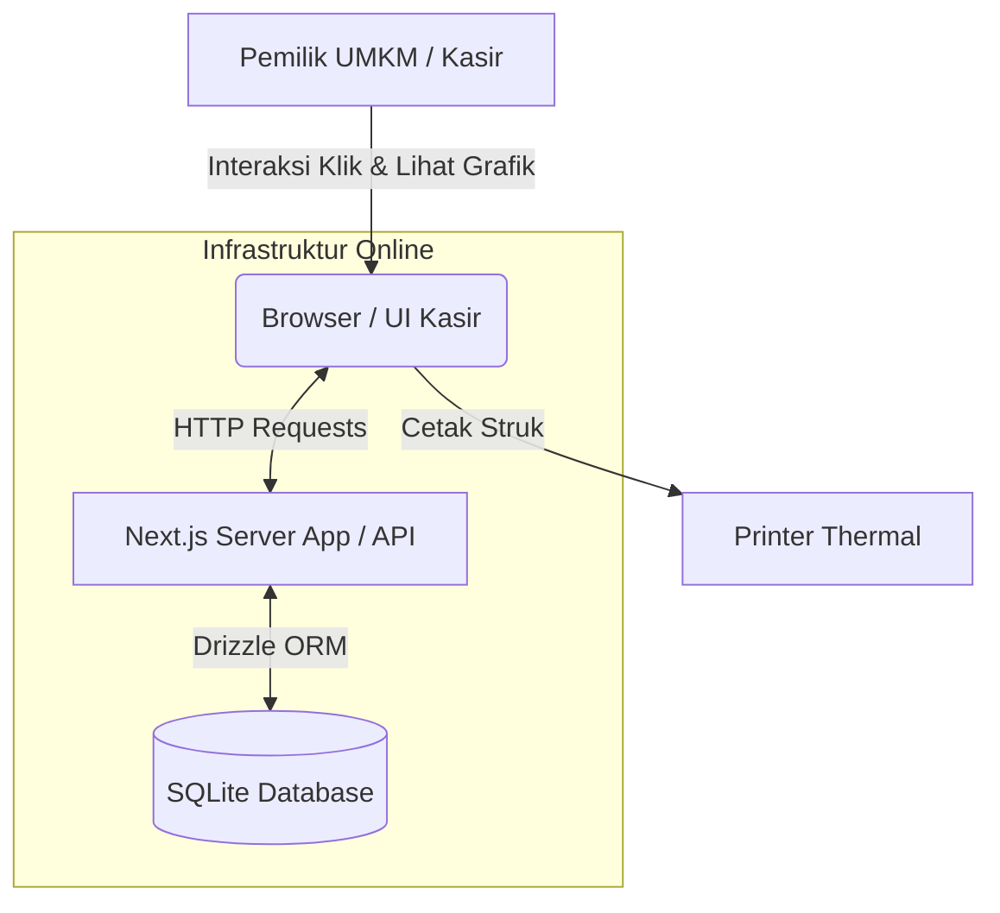
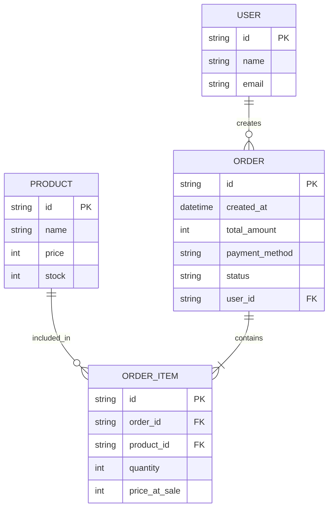

# PRD — Project Requirements Document

## 1. Overview
Banyak pelaku UMKM saat ini masih mencatat penjualan dan stok barang secara manual, atau menggunakan sistem kasir yang terlalu rumit. Hal ini menyebabkan kesulitan dalam melacak performa bisnis harian, memantau ketersediaan stok, dan memahami tren penjualan mingguan/bulanan. 

**"Ngasir"** hadir sebagai aplikasi *Point of Sale* (POS) berbasis web yang sangat sederhana, intuitif, dan *fullstack*. Aplikasi ini dirancang khusus untuk UMKM berskala kecil (dengan katalog sekitar 5-20 produk). Nilai jual utama dari Ngasir adalah kehadiran *dashboard* analitik berbasis grafik visual yang ringan, sehingga pemilik bisnis (orang non-teknis) dapat dengan mudah memahami kesehatan usahanya dalam sekali lihat. Interaksi produk difokuskan sepenuhnya pada kemudahan klik melalui antarmuka layar tanpa memerlukan alat *scanner* eksternal.

## 2. Requirements
- **Aksesibilitas:** Wajib beroperasi secara *online* agar pemilik bisnis dapat memantau data secara *real-time* dari perangkat mana saja.
- **Kompabilitas Perangkat Keras:** Sistem antarmuka (UI) harus dapat memicu *Receipt Printer* (printer thermal/struk) melalui dialog pencetakan *browser*.
- **Metode Pembayaran:** Saat fase awal berjalan (V1), sistem hanya menerima pembayaran Tunai (Cash). Namun, kode dan basis data harus disiapkan untuk integrasi *Payment Gateway* (seperti Midtrans/Xendit) di kemudian hari.
- **Kapasitas Optimal:** Sistem dioptimalkan untuk performa cepat pada katalog toko kecil (5 hingga 20 jenis barang).
- **Basis Data:** Menggunakan **SQLite** untuk kesederhanaan instalasi, portabilitas, dan manajemen data tanpa memerlukan server database terpisah yang kompleks.

## 3. Core Features
- **Dashboard Analitik (Visual Graph):** Tampilan layar utama yang berisi grafik ringkas. Menampilkan visualisasi:
  - Total Penjualan Harian.
  - Grafik Tren Penjualan Bulanan.
  - Status/Peringatan Stok Barang menipis.
- **Modul Kasir (POS):** Layar tempat transaksi berlangsung. Mendukung fitur tambah ke keranjang melalui klik pada gambar atau nama produk di layar, perhitungan total, penerimaan pembayaran kas, dan tombol fitur "Cetak Struk".
- **Manajemen Inventaris:** Halaman sederhana untuk menambah, mengedit, atau menghapus produk (Nama Barang, Harga Jual, Sisa Stok).
- **Riwayat Transaksi:** Catatan semua penjualan yang telah terjadi beserta status pembayarannya untuk kebutuhan audit/pencocokan uang kas.

## 4. User Flow
1. **Login:** Pengguna (Kasir/Pemilik) masuk ke dalam aplikasi menggunakan *username* dan *password*.
2. **Dashboard Review:** Setelah masuk, pengguna melihat grafik penjualan hari ini dan mengecek apakah ada stok barang yang harus segera ditambah.
3. **Mulai Transaksi (POS):** Pelanggan datang membawa barang. Kasir masuk ke halaman Kasir.
4. **Input Barang:** Kasir mengklik gambar atau nama barang yang tersedia di layar untuk memasukkan ke keranjang. Pilihan jumlah barang disesuaikan melalui tombol tambah/kurang pada layar.
5. **Checkout:** Kasir menekan tombol "Bayar". Sistem menampilkan total. Kasir memasukkan uang tunai yang diterima, sistem menampilkan kembalian.
6. **Selesai & Cetak:** Transaksi tersimpan (stok otomatis berkurang), dan kasir menekan tombol "Cetak Struk" untuk memberikan bukti pakai printer kasir. Lanjut ke pelanggan berikutnya.

## 5. Architecture
Aplikasi "Ngasir" menggunakan arsitektur Monolith modern (Aplikasi dan API berada dalam satu proyek) yang terhubung ke basis data **SQLite**. Perangkat keras kasir (printer) akan berinteraksi langsung melalui antarmuka *browser*.

## 6. Database Schema
Basis data akan dirancang sesederhana mungkin menggunakan **SQLite** untuk memfasilitasi kebutuhan penjualan dan persiapan *Payment Gateway* di masa depan.

**Daftar Tabel Utama:**
1. **User:** Menyimpan data pengguna aplikasi (kasir/pemilik).
   - `id` (String/UUID) - ID Unik.
   - `name` (String) - Nama pengguna.
   - `email` (String) - Kredensial masuk.
2. **Product:** Menyimpan data barang dagangan.
   - `id` (String/UUID) - ID Unik barang.
   - `name` (String) - Nama produk.
   - `price` (Int) - Harga jual produk.
   - `stock` (Int) - Jumlah stok tersedia.
3. **Order:** Menyimpan ringkasan transaksi kasir.
   - `id` (String/UUID) - ID Unik/Nomor Struk.
   - `created_at` (Datetime) - Waktu transaksi (untuk grafik harian/bulanan).
   - `total_amount` (Int) - Total nominal belanja.
   - `payment_method` (String) - Default: "CASH" (Disiapkan untuk "QRIS"/"VA" nanti).
   - `status` (String) - "PAID" atau "PENDING".
4. **OrderItem:** Rincian barang apa saja yang dibeli di dalam satu transaksi (Order).
   - `id` (String/UUID) - ID Unik.
   - `order_id` (String) - Relasi ke tabel Order.
   - `product_id` (String) - Relasi ke tabel Product.
   - `quantity` (Int) - Jumlah barang dibeli.
   - `price_at_sale` (Int) - Harga barang saat dibeli.

## 7. Tech Stack
Berikut adalah rekomendasi teknologi untuk membangun "Ngasir" yang mudah di-*(maintain)*, responsif, dan siap produksi:

- **Framework Web (Frontend & Backend):** Next.js (App Router) — Memungkinkan pembuatan antarmuka dan *backend logic* di dalam satu *codebase*.
- **Styling UI:** Tailwind CSS & shadcn/ui — Untuk membuat antarmuka kasir yang modern, cepat, layar penuh, dan rapi secara instan.
- **Chart/Grafik:** Recharts (React Library) — Sangat mudah diintegrasikan dengan Next.js untuk membuat grafik Penjualan Harian dan Tren Bulanan yang cantik.
- **Database:** **SQLite** — Basis data ringan berupa file yang tidak memerlukan proses server database terpisah, cocok untuk skala UMKM.
- **ORM:** Drizzle ORM — Penghubung antara kode TypeScript (Next.js) dengan basis data SQLite yang sangat ringan, cepat, dan *type-safe*.
- **Authentication:** Better Auth — Solusi log in yang aman dan simpel untuk *stack* Next.js.
- **Deployment & Hosting:** 
  - Aplikasi (Next.js): Vercel (dengan integrasi LibSQL/Turso) atau VPS standar.
  - Database: Penyimpanan file persisten (jika menggunakan VPS) atau layanan kompatibel SQLite seperti Turso/LibSQL (jika menggunakan serverless/Vercel) untuk memastikan data tetap aman dan dapat diakses online.